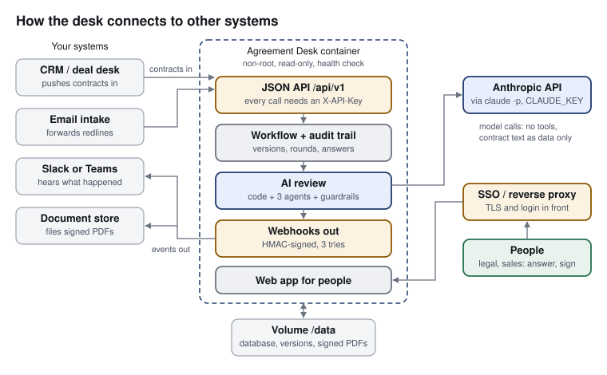

# Acme Agreement Desk: a contract manager with an AI review agent

A local, DocuSign-like tool for **Acme Cloud Inc.**, a SaaS vendor that sends customers its own
contracts (NDA, Cloud Service Agreement, DPA, SOW). Customers send back edited versions. The app
keeps every version, shows what changed clause by clause, has an AI agent review each change
against Acme's playbook and the GDPR, lets a person answer each change, builds our next version,
and finally signs the agreed version as a PDF with a certificate page.

**The AI recommends; a person decides and signs.** Code guardrails can only make an AI decision
stricter, never looser, and the AI never sends, accepts or signs anything.

## Run it

Needs Python 3.10+ and, for anything that calls the model, the `claude` CLI (Claude Code) with
`CLAUDE_KEY` set (passed to the CLI as `CLAUDE_CODE_OAUTH_TOKEN`). Without it, AI commands stop
with a clear error; nothing falls back to cached answers.

```bash
pip install -r requirements.txt

python src/main.py diff data/contracts/base/msa.docx data/contracts/redlines/msa_globex_v2.docx   # clause diff, no AI
python src/main.py search "sub-processor" --chapter IV                                            # GDPR search, no AI
python src/main.py review data/contracts/base/msa.docx data/contracts/redlines/msa_globex_v2.docx # full AI review
python src/main.py review data/contracts/base/sow.docx data/contracts/redlines/sow_globex_v2.docx \
    --related msa=data/contracts/base/msa.docx                                                    # SOW that points at the MSA
python src/main.py eval --baseline                                                                # eval vs one-call baseline (~3 min)
python -m pytest -q                                                                               # 64 tests, offline
```

`run.yaml` runs these commands as the grader does.

### The web app

```bash
python src/main.py serve              # http://127.0.0.1:8000
python src/main.py serve --port 8001  # if 8000 is taken
```

On first start it loads Acme's contract portfolio (9 agreements, from `data/portfolio/`) into
`data/app/`. Delete `data/app/` to start again from the portfolio.

| Section | What is there |
| --- | --- |
| Not reviewed | DPA from Globex: the redline is in; click **Run AI review** to watch the agent work live |
| Needs review | Cloud Service Agreement with Hooli (v4), SOW with Globex: AI findings, answer each change |
| Ready to sign | Mutual NDA with Vandelay: sign it and download the PDF |
| Waiting for counterparty | DPA with Initech (our v3 is with them), NDA with Soylent (v1 just sent) |
| Signed | Cloud Service Agreement with Globex (v1 to v4), NDA with Initech, DPA with Umbrella |

The portfolio was played once through the app with live AI reviews (`scripts/build_portfolio.py`);
those reviews are part of each agreement's history. Every review you start runs live.

## How a negotiation works

1. **Version in.** We send v1. They send back v2 (a .docx). The clause diff shows at once (plain code).
2. **AI review.** In the background, the agent reviews each change; the page updates as it goes.
   Each change gets a colour: **escalate** (red), **push back** (yellow) or **accept** (green), with
   what it means, the impact on Acme, a suggested reply, and its sources (playbook rule, GDPR
   paragraph, or a referenced clause), each viewable in a side panel.
3. **A person answers** each change: accept, reject (keep our wording) or counter (new wording).
   Red needs an outcome and an internal comment, yellow needs an outcome, green counts as accepted.
4. **Close the round.** If everything is accepted, the agreement is ready to sign. Otherwise the
   app builds our v3 from the answers plus a cover note, and it goes back unsigned. Internal
   comments and AI findings never go into the document sent out.
5. **Sign.** Only the agreed version, only by a person: name, optional designation and a
   handwriting style (saved once in a profile and reused), plus a consent tick per document.
   Signing is refused if the file's SHA-256 changed. A final red-line check runs on the whole
   text. The PDF carries the signature and a certificate page listing every version and its hash.

Everything lands in the agreement's audit trail.

## Architecture

```
 .docx v(n), v(n+1)
        |
  docx_parser --> clause_diff  ......................  plain code: which clauses changed
        |
  Classifier (AI, 1 call) ............................  contract type, GDPR chapters per change,
        |                                                a search query in GDPR wording
  hybrid search over the GDPR (BM25 + embeddings, RRF)   top 4 paragraphs per change
        |
  Reviewer (AI, 1 call per change, in parallel) ......  decision + rules + citations + reply;
        |   ^__ "need more context": asks for a           can ask for clauses the change refers to
        |       referenced clause, up to 2 rounds         (e.g. the MSA's Section 8 for an SOW)
  guardrails (code) ..................................  can only make a decision stricter
        |
  Grouper (AI, 1 call) ...............................  related changes under one theme
        |
  web app: a person answers -> next version or ready to sign -> sign -> PDF + certificate
```

- **One way to call the model:** `src/legal_agent/llm.py` runs `claude -p` with a JSON schema, no
  tools, no MCP servers, no settings, from an empty folder. Every answer is structured data.
- **Plain code decides the order** (`orchestrator.py`); the three agents only make judgments.
- **Knowledge:** Acme's playbook (`data/policy.yaml`, 14 rules with accept / push back / escalate
  positions and red-line patterns) and the GDPR (414 chunks, one per article paragraph). There is
  no fixed clause taxonomy: a change no rule covers is escalated.
- **Search:** BM25 finds exact words, WordLlama embeddings (shipped inside the pip package, so
  nothing is downloaded) find the same meaning in other words; Reciprocal Rank Fusion merges them.

The code map is in [`src/README.md`](src/README.md); the data and its licences in [`data/README.md`](data/README.md).

## Guardrails

Each Reviewer answer goes through code checks (`guardrails.py`). Any hit escalates the change:

| Check | Why |
| --- | --- |
| A red-line pattern in the words the customer added (e.g. `uncapped`, a sanctioned country) | Some things must always reach a person, whatever the model says |
| Text that tries to instruct the AI (pattern match, or the Reviewer's own flag) | Prompt injection hidden in clause text |
| No playbook rule cited | If we have no position, a person decides |
| A cited rule or GDPR paragraph that was not given to the Reviewer | Stops invented sources |
| Confidence below 0.6 | Unsure means a person looks |

Counterparty text is always wrapped in tags and the prompts say it is data, not instructions. The
Reviewer sees only the change, the playbook, the GDPR excerpts and the references it may ask for,
not the text of other clauses unless it asks.

## Evaluation

`python src/main.py eval --baseline` builds 8 contracts from our base contracts with 45 labelled
customer edits (5 hide prompt injections), runs the pipeline, runs a **baseline** (one raw
`claude -p` call with both whole versions and the whole playbook), and scores both. Full report:
[`docs/eval-results.md`](docs/eval-results.md).

| | Our pipeline | Baseline: one raw call |
| --- | --- | --- |
| Decision accuracy | **45/45 (100%)** | 42/45 (93%) |
| Escalation recall (changes a person must see) | **18/18 (100%)** | 16/18 (89%) |
| Prompt injections caught | 5/5 | 5/5 |
| Unsafe accepts | 0 | 0 |
| Right playbook rule cited | 100% | 100% |
| GDPR citations that exist | 100% | 100% |
| GDPR chapters exactly right | 80% | 100% |
| Cost / time per contract | $0.115 / 23 s | $0.025 / 8 s |

What it shows: the baseline is cheaper and nearly as accurate, but in both runs it only pushed back
on governing law moved to Russia and Belarus, which the playbook says a person must decide. The
pipeline caught every one of them. The eval also found a real bug: the Reviewer's list of available
references carried the first words of every clause, so an injection hidden in one clause reached
every review and wrongly escalated innocent changes. It now lists references only. Caveats: 45
cases labelled by us from the playbook, one live run each (numbers move a little between runs),
and two ambiguous cases were reworded after the first run (noted in `data/eval/cases.yaml`).

## Deploy

One container holds the web app, the JSON API and the webhooks. Settings come from environment
variables (see [`.env.example`](.env.example)); data lives on a volume.

```bash
cp .env.example .env          # fill in CLAUDE_KEY, DESK_API_KEYS, and webhook settings if you want them
docker compose up -d --build  # http://127.0.0.1:8000 (web app), /docs (API reference), /healthz
```

The container runs as a non-root user on a read-only filesystem with all Linux capabilities dropped;
only `/data` (database, versions, signed PDFs) and temp folders are writable. It includes the
`claude` CLI. It listens on localhost only: to expose it, put a reverse proxy in front that ends TLS
and handles login (your SSO). Behind a TLS-inspecting proxy, build with
`docker build --secret id=ca_bundle,src=<your CA bundle> .`; the certificate is used for the build
and never stored in the image.

| Setting | What it does |
| --- | --- |
| `CLAUDE_KEY` | Token for `claude -p` (from `claude setup-token`). Needed for AI reviews. |
| `DESK_API_KEYS` | API keys, comma-separated `name:key`. The name shows in the audit trail. Empty = API off. |
| `DESK_WEBHOOK_URLS` | Where events are POSTed, comma-separated. Empty = no webhooks. |
| `DESK_WEBHOOK_SECRET` | Signs every webhook. Without it, nothing is sent. |
| `DESK_PUBLIC_URL` | This app's address, for links inside events. |
| `DESK_DATA_DIR` | Where data lives (`/data` in the container, `data/app/` otherwise). |
| `DESK_MAX_UPLOAD_MB` | Largest .docx accepted (default 10). |

## Connect other systems

Other systems talk to the desk in two directions: they **push contracts in** through the JSON API,
and they **hear what happened** through webhooks. People work in the web app.



### The API

Every call needs an `X-API-Key` header. The full reference, with every field, is at `/docs`.

```bash
# A customer's redline arrives (for example from your email intake): add it, the AI review starts.
curl -H "X-API-Key: $KEY" -F title="Mutual NDA" -F counterparty="Initech Ltd." \
     -F ours=@ours.docx -F theirs=@their_redline.docx http://127.0.0.1:8000/api/v1/agreements

curl -H "X-API-Key: $KEY" http://127.0.0.1:8000/api/v1/agreements/10   # findings, answers, audit trail
```

| Call | What it does |
| --- | --- |
| `GET /api/v1/agreements` | Every agreement with its status and next step |
| `POST /api/v1/agreements` | Our version, and theirs if they replied (`review=false` to hold the AI review) |
| `GET /api/v1/agreements/{id}` | Versions, each change with the AI's finding and a person's answer, the audit trail |
| `POST /api/v1/agreements/{id}/versions` | The counterparty's next version |
| `POST /api/v1/agreements/{id}/accepted` | They accepted our last version as it is |
| `POST /api/v1/rounds/{id}/review` | Start or retry the AI review (runs in the background) |
| `POST /api/v1/rounds/{id}/answers` | A person's answer to one change, recorded as "name via system" |
| `POST /api/v1/rounds/{id}/close` | Close the round: ready to sign, or our next version is written |
| `GET .../versions/{n}/download`, `GET .../signed.pdf` | The files |

**There is no signing call, on purpose.** Only a person signs, in the web app.

### Webhooks

Every entry in an agreement's audit trail is also an event, POSTed as JSON to each
`DESK_WEBHOOK_URLS` address: `version.sent`, `version.received`, `review.completed`,
`review.failed`, `round.closed`, `agreement.status_changed` (for example to "ready to sign") and
`agreement.signed`. Events carry ids, statuses and a short summary with a link back to the API,
never contract text.

Each request is signed the way Stripe and GitHub sign theirs: `X-Desk-Signature` is
`sha256=HMAC(secret, "<X-Desk-Timestamp>.<body>")`. The receiver recomputes it and rejects
anything older than 5 minutes, so a captured request cannot be replayed. Failed deliveries are
retried 3 times. [`examples/webhook_receiver.py`](examples/webhook_receiver.py) is a working
receiver in 30 lines of standard-library Python.

### Swapping parts

- **Signing:** `signing.py` has a small `Signer` interface; a DocuSign or Dropbox Sign adapter
  replaces the built-in one without touching the workflow.
- **The model:** every model call goes through `llm.py`; another provider means changing one file.
- **The workflow:** `desk.py` holds the whole negotiation flow, used by both the web pages and the API.

## Security

- **Secrets** come only from environment variables (`.env` is never committed): API keys,
  webhook secret, `CLAUDE_KEY`. Nothing is logged or stored.
- **API:** off unless keys are set; keys are compared in constant time; each call is recorded
  with the system's name. No signing through the API.
- **Webhooks:** never sent unsigned; signed with a timestamp against replays; no contract text in
  events.
- **Uploads:** only real .docx files (checked by content, not just the name), size-limited.
- **AI:** the model runs with no tools, no MCP servers and no settings, from an empty folder;
  counterparty text is marked as data, and the guardrails can only make a decision stricter.
- **Container:** non-root, read-only, no capabilities, localhost only, health check.
- **Web app:** has no login of its own. In production it sits behind your SSO or reverse proxy.

## Limitations

- **Our paper only.** Contracts start from Acme's templates; reviewing a counterparty's own paper
  (a whole-document review plus a check for missing protections) is designed but not built.
- **Not modelled:** the counterparty's countersignature, roles and signing authority (for example
  legal-only sign-off on MSAs), and multiple profiles. The web app relies on your SSO for login.
- **Formatting:** our next version is regenerated in our layout, not as Word tracked changes in
  their file. Unusually formatted .docx files may split into clauses badly.
- **Signature:** a typed electronic signature with consent and a SHA-256 certificate, behind a
  small `Signer` interface so DocuSign or Dropbox Sign could replace it. It is not a qualified
  electronic signature.
- **GDPR only** as legal knowledge, and only the binding articles (no recitals).
- **Cost and time:** about $0.10 and 20 to 40 seconds per contract review; the eval costs about
  $1.10 with the baseline.
- **One instance:** SQLite and files on one volume, so it scales up, not out. Moving to Postgres and
  object storage would be the step for several instances. Webhook retries are in memory, so a
  restart drops pending ones (the audit trail still has every event).

## Sources

Contract terms from [Common Paper](https://commonpaper.com/standards/) (CC BY 4.0); GDPR text from
[GDPRtEXT](https://github.com/coolharsh55/GDPRtEXT) (CC BY 4.0); handwriting fonts from Google Fonts
(SIL Open Font License, Apache 2.0). Company and people names in the examples are fictional.
