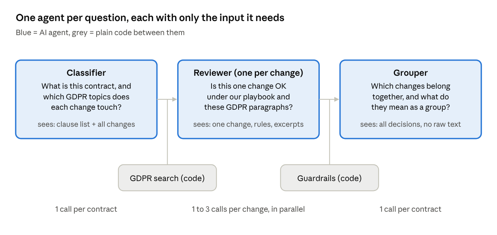

# Legal Agreements Agent

## Main optimization aims

1. **Missing a change is to be avoided at all costs.** A wrong "accept" will cost more than a reviewer spending some extra time.
2. **Every decision should be easily verifiable.** Every decision should track to a law, a rule or a clause and this should be easily accessible. If people can't check it, they won't trust it.
3. **Should easily fit into existing systems.** The tool should be able to be connect directly to inbox instead of having its own separate app because then its just extra work.
4. **Simple and lightweight.** Add enough guardrails that there are no errors but avoid any unneeded complexity.

## One prompt, an agent, or a pipeline?

| Option | Why not (or why) |
| --- | --- |
| One big prompt with both contracts | Cheapest, but it will require a lot of tokens to read through complete knowledge base (GDPR and Playbook) every time, and is more susceptible to hidden prompt injections. We kept it as our baseline. |
| An autonomous agent with tools | Flexible, but it picks its own steps, so runs differ and are hard to test or explain and might bypass basic guardrails. Tools also widen the door for prompt injection. |
| **A fixed pipeline (chosen)** | Code sets the order and the AI answers a few small questions. More code, roughly 2 to 4 times the model cost, but every step can be tested and checked. |

The pipeline is the best option because multiple agents supervised by a clear set of rules and guardrails lessen the risk of an outside injection or a hallucination causing major issues. Each agent also keeps others in check and at each step the behavior is monitored. Capabilities of each agent are limited and any major flags are directly escalated to a human with simple readable context.

## Why three agents

**One agent per question that needs judgment and a different view of the data.**

- **Why not one?** The questions need different inputs at different times. Classifying needs the whole outline. Judging works best on one change at a time, so a trick in one clause can't affect the rest. Grouping only works once everything is judged.
- **Why not two?** Merge the Classifier into the Reviewer and each Reviewer has to search the law itself, which means tools and loops. The contract type also decides which rules apply, so it must come first. Merge the Grouper in and a Reviewer looking at one change can't see patterns across five.
- **Why not more?** We considered a retriever, a critic, a reply drafter and a cover-letter writer. Each job was already done better by code or by one of the three, and every extra agent adds cost, delay and another way to fail.

## Code where there's one right answer

Our test for each step: one correct answer means code, and judgment means AI. Code is free, instant and gives the same result every time.

- **Code:** finding what changed, the order of steps, running the search, building our reply document, and the guardrails. The guardrails can only make a decision stricter: red-line words, instructions aimed at the AI, no rule cited, a made-up source, low confidence.
- **AI:** the three questions above, each answered in a fixed JSON format with no tools at all. The model can't browse, run anything or be told by a contract to go and fetch something.
- **No framework.** LangChain and friends would add a big dependency and behaviour we didn't write, for a flow that is three function calls. The one loop we allow is bounded: the Reviewer may ask for a clause the change refers to ("subject to Section 8"), at most twice.

## What the AI knows

- **Acme's playbook:** 14 rules saying what we accept, push back on or escalate, kept in one readable file so legal can change a position without touching code. If no rule covers a change, a person decides.
- **The GDPR, and only the GDPR:** most of a SaaS company's contract risk is about personal data, so one law done well beat many done shallowly. We split it into one piece per paragraph, so every citation points at exact text.
- **Search:** keyword search catches exact terms ("Article 28"), and embeddings catch the same idea in other words. We use both, in memory, with no vector database needed at this size. The AI first rewrites each change in the law's own wording, because contracts say "Provider" where the GDPR says "processor".
- **What we dropped:** labelling clauses with a standard taxonomy from public datasets. Those labels don't match Acme's playbook and nobody acts on them.

## People stay in charge

The AI never accepts, sends or signs anything. Effort follows risk: green changes count as accepted, yellow ones need a decision, and red ones need a decision plus a written reason. Negotiation runs in rounds (v1, their v2, our v3), and nobody signs halfway. Our internal notes never go out in the document. Signing is deliberately boring: a typed name, a consent tick, and a fingerprint of the exact file. It sits behind a small interface, so DocuSign could replace it.

## Plugging into other systems

The web pages and a JSON API share one workflow module, so a contract from a CRM gets exactly the same checks as one uploaded by hand.

| We chose | Over | Because |
| --- | --- | --- |
| REST API with one key per system | OAuth, GraphQL | A few trusted internal systems don't need the extra weight. OAuth can come later |
| Signed webhooks for events | Polling, or a message queue like Kafka | No wasted calls and no extra infrastructure. Slack and CRMs accept webhooks directly |
| HMAC signature with a timestamp | Unsigned events, or mutual TLS | Receivers can trust an event without a painful setup |
| One locked-down container | Separate services | Less to run and secure at this size |

Two deliberate gaps. The API cannot sign, so a bug or a leaked key can't commit the company to anything. And the web app has no login of its own, because companies already have SSO and it belongs in front.

## Did the design pay off?

We tested the design itself: 45 labelled edits across 8 contracts (5 hiding instructions to the AI), run through our pipeline and through the one-big-prompt baseline. Across repeated runs, the pipeline got every decision right and escalated every change that needed a person. The baseline came close overall and was cheaper and about 3 times faster, but it treated a contract moved under Belarusian law, and usually Russian law, as a routine pushback. That's exactly the quiet miss we designed against.

The test also caught a flaw in our own design: an instruction hidden in one clause leaked into every other review. We fixed it and added a test. These are small tests written by us, not an independent benchmark.

## Next, with more time

1. Review contracts the customer drafted, including a check for what's *missing*.
2. A bigger eval, labelled by a lawyer.
3. Send our replies as Word tracked changes, and move to Postgres and a durable queue when one instance isn't enough.

